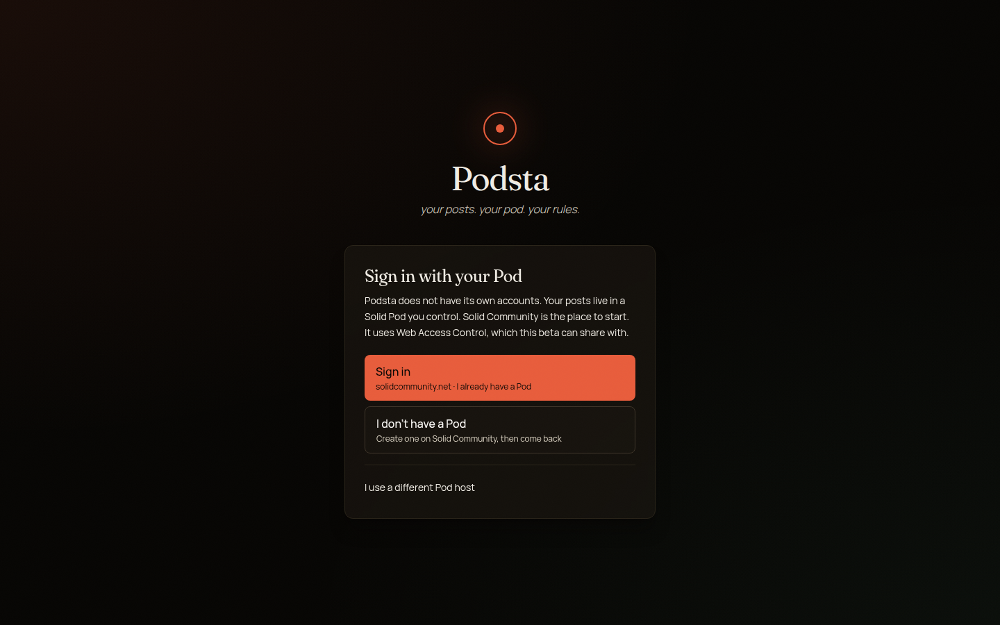
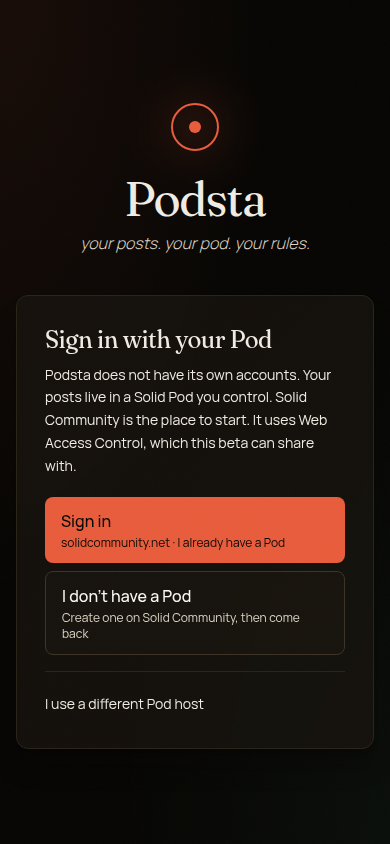
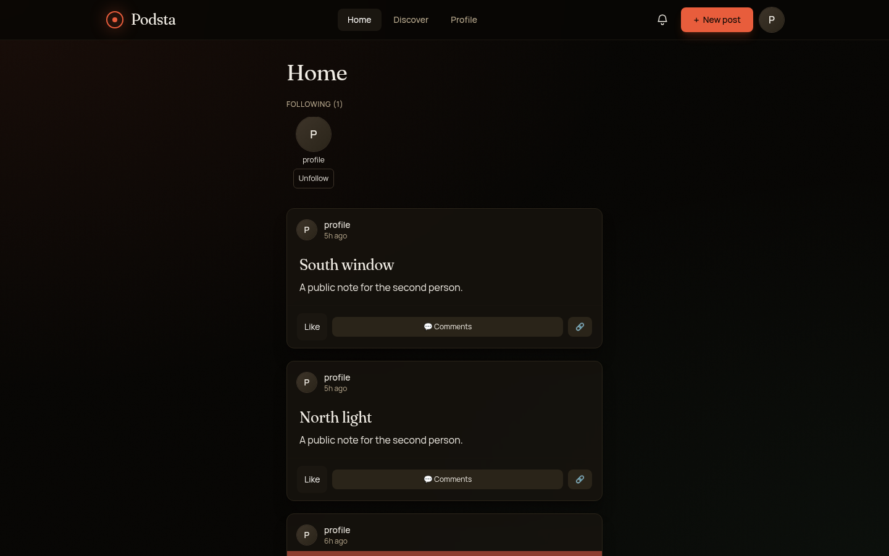
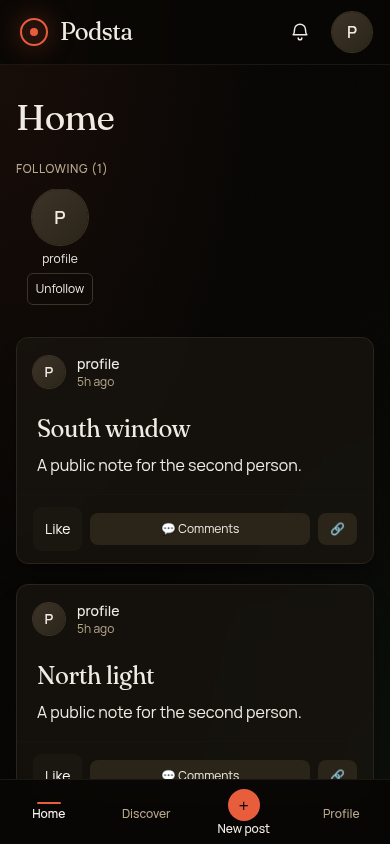
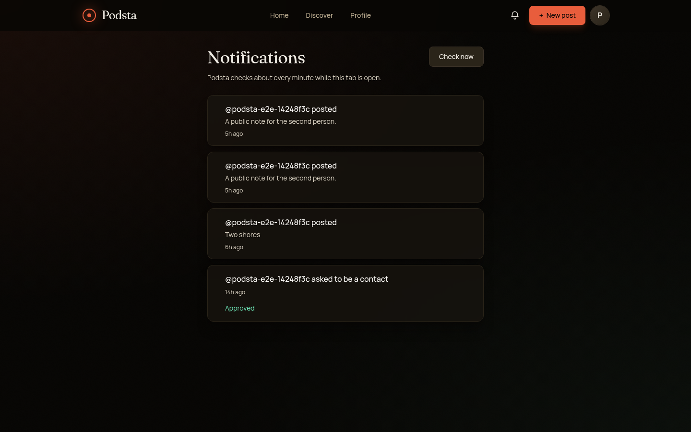
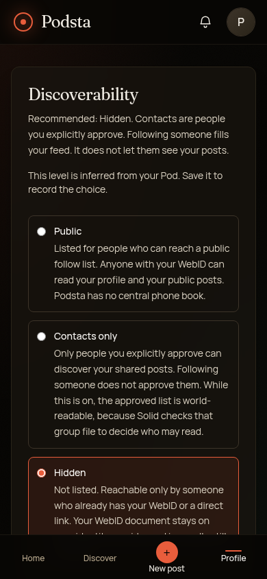
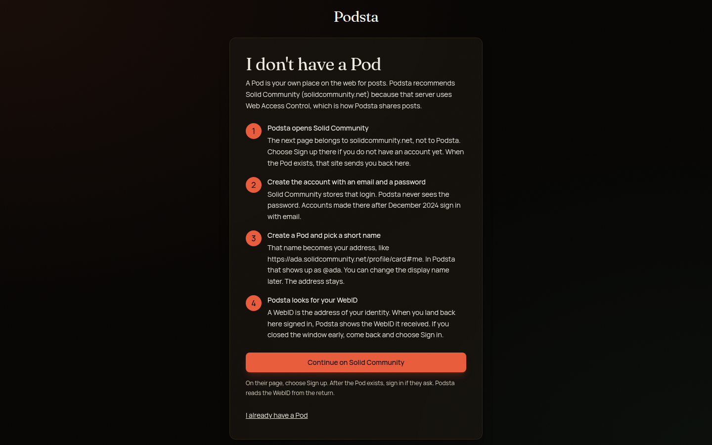
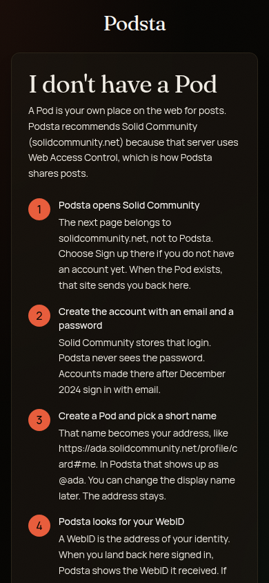

# Podsta

> Your posts. Your Pod. Your rules.

Podsta is a photo-and-text app that stores everything in your [Solid Pod](https://solidproject.org). There is no Podsta server and no central directory. The signed-in browser talks to your Pod, and to the Pods of people you follow, with Web Access Control.

**Try it:** [https://teebooted.github.io/Podsta/](https://teebooted.github.io/Podsta/) · **New to Solid?** [https://teebooted.github.io/Podsta/start/](https://teebooted.github.io/Podsta/start/)

A new profile is Hidden. You choose Contacts or Public later. A post cannot be more open than the profile.

## Features

- Home is the following feed. Your own posts live on Profile as a grid. A weekly photo prompt appears there only when someone you follow posted in the last seven days. You can skip it until next week. It stays on this device, with no extra notification.
- Text posts, and photo posts of up to ten pictures, with a carousel in the feed and in the viewer.
- One-tap looks while you write a post: As shot, Cream, Sunshine, Coral, Berry, Plum, Mint, and Soft, each with a live thumbnail. Square or 4:5, brightness, and warmth sit next to them. The look is drawn into the photo on this device before it is uploaded. Leaving a photo as shot adds no extra taps.
- Crop and rotate before upload. Large photos are resized in the browser and a smaller thumbnail is what the feed loads. Camera metadata is not kept on the copy stored in the Pod. Drag-and-drop works on a desktop, and a progress bar stays short of 100% until the Pod responds. A failed upload can be retried without sending photos that already landed.
- Per-post audience: Only me, Contacts, or Public, capped by the profile.
- If the pod is unreachable or the device is offline, a new post, like, or comment stays on this device, shows as waiting to send, and goes out when the connection returns. A failed upload does not throw away the caption or the photos.
- Instagram import on Profile. Choose the JSON zip or the unzipped folder from Instagram's download, preview the posts, and save the ones you pick. Original dates and captions are kept, camera location is removed, and new posts start as Only me unless you choose otherwise. Posts already saved are skipped, and a stopped import can continue.
- Comments live in the commenter's Pod. The author publishes the list with the same audience as the post, and can hide one or block that person. Other people cannot write the author's Pod.
- Likes stored in the liker's Pod. The count stays on the author's Pod unless they turn on "Show like counts". Home stays newest first.
- In-app notifications for new posts from people you follow, comments and likes on your posts, and contact requests or approvals. The app polls. After you post, follow, like, or comment, this device can show a badge and a notification for new comments, likes, and contact requests. It does not run a notification server.
- Saved posts. The list is a private file in your Pod (`podsta/favorites.ttl`). It stores the post address and the time you saved it, not a copy of the photo or the caption. A post you can no longer read shows as unavailable.
- Captions and notes can include `#tags`. A tag page lists only posts you can already read: yours, including private ones, and posts from people you follow. There is no central tag directory.
- Share a public or contacts post to another app on your device. A private post is not offered. A contacts post shares the link only, not the caption. Nothing is sent to a Podsta server.
- Each photo can have a description for someone who cannot see it. The description is stored with the photo, uses the same audience, and is not the caption.
- Discover by WebID, with copy-my-WebID, invite links, and a QR code. Opening an invite follows the inviter, approves them as a contact, and posts a notice to their inbox. Their app follows back and approves the new person. A short name like `@ada` is derived from the WebID. It is not a registered handle.
- A sign-up guide for people without a Pod. Solid Community is the recommended host. An existing Web Access Control Pod can sign in directly.
- Phone layout with Home, Discover, New post, and Profile. Desktop uses the header. Keyboard: `h` home, `d` discover, `p` profile, `s` saved, `n` new post. Shortcuts are ignored while you are typing or a dialog is open. Saved posts are also in the account menu.

Podsta can be installed. The production build registers a service worker, and the feed and your own posts are kept on this device so a Pod that does not answer does not leave a blank page.

## Screenshots

Signed-out start, and a signed-in feed, from the current build.













The guide for someone without a Pod is at `/start`.





## Quick start

You need a Solid Pod on a server that uses Web Access Control.

**No Pod yet.** Open Podsta and choose **Create my Pod**. That opens [Solid Community](https://solidcommunity.net). Create the account there with an email and a password. Accounts created after December 2024 sign in with that email. Podsta never sees the password. When the Pod exists, that site sends you back here. Your WebID looks like `https://ada.solidcommunity.net/profile/card#me`, which Podsta shows as `@ada`.

**You already have an account.** Choose **I already have an account**, type your name such as `@ada`, and choose **Sign in**. A blank name opens Solid Community. A name from somewhere else looks like `@ada@solidweb.org`. That only picks the host. It does not look the name up, and it is not a registry. Other hosts are under **Advanced**. [solidweb.org](https://solidweb.org) also uses Web Access Control. Inrupt PodSpaces is listed so you can see why it is not supported: it uses access policies this app cannot write.

After sign-in you can skip the short tour. The profile starts Hidden. Copy your WebID from Home or Discover and send it to someone, or follow a WebID you already know. Invite links use `/invite?webid=`. Signing in through one follows that person, approves them as a contact, sends a contact request, and opens Home. A notice in their inbox asks their app to follow back and approve you. Public posts can show there. A private profile stays private. Undo is on Home. A starter pack is a public file in your pod, `podsta/packs/starter.ttl`, with up to 50 addresses. Its link and QR code open `/pack?url=`. Follow all and each person use the same follow rules as Discover.

## For developers

Node.js 22. That is the version CI uses.

```bash
npm ci
npm run dev       # http://localhost:5173
npm test          # node --test tests/*.test.js
npm run test:e2e  # Playwright against the production build, including two local pods
npm run lint      # eslint src
npm run build     # static files in dist/
npm run preview   # serve the production build
```

`npm run dev` opens a browser tab. Solid sign-in on localhost has to stay on `localhost`, not `127.0.0.1`, because the OIDC client is registered for that origin. The end-to-end run starts a Community Solid Server on this machine and signs in two accounts.

`dist/` is a static site. GitHub Pages serves it at `/Podsta/`. `vercel.json` rewrites every route to `index.html` and sets a Content-Security-Policy, `X-Frame-Options: DENY`, and a referrer policy. The Pages build injects the same policy as a meta tag, because Pages cannot set response headers. Production needs HTTPS. Localhost is the exception Solid allows for development.

GitHub Pages builds with `PAGES_BASE=/Podsta/`. That workflow copies `index.html` to `404.html`, so `/invite`, `/post`, and `/pack` still open. The Solid client id for that origin is `public/solid-client-id.json`. Localhost and CI stay at `/`, and localhost keeps dynamic registration.

See [docs/ARCHITECTURE.md](docs/ARCHITECTURE.md) for the Pod layout, access rules, and notification polling. See [CONTRIBUTING.md](CONTRIBUTING.md) before opening a change, and [CHANGELOG.md](CHANGELOG.md) for what shipped. [docs/IMPROVEMENT_PLAN.md](docs/IMPROVEMENT_PLAN.md) records what is still open.

## License

[MIT](LICENSE). Copyright 2026 Matthew Nielsen.
